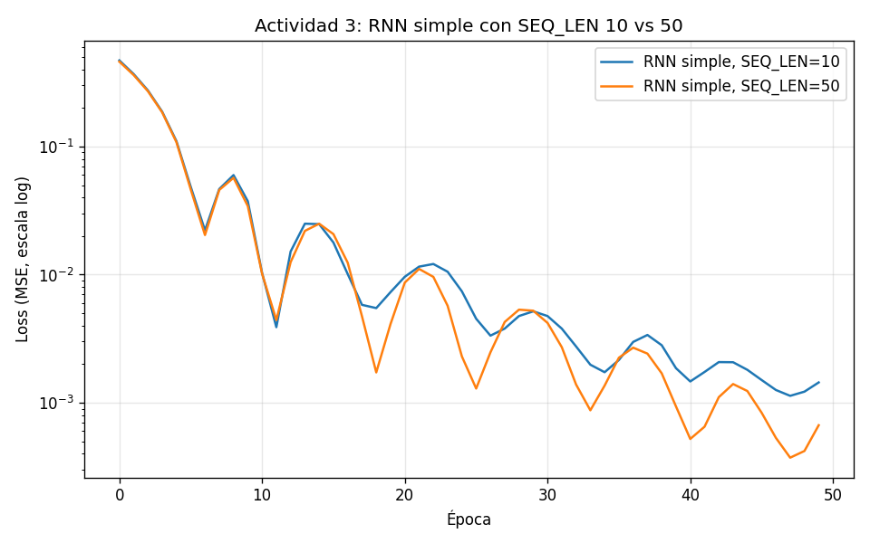
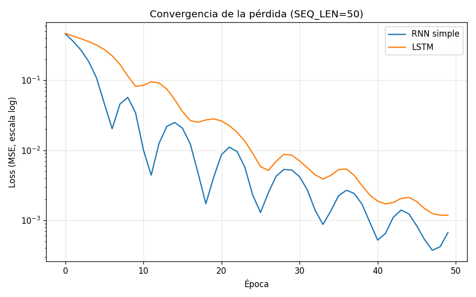
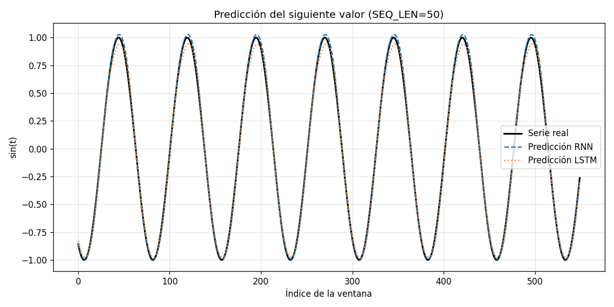

# Práctica 06: Redes Recurrentes (RNN y LSTM) en PyTorch

**Curso:** Inteligencia Artificial / Aprendizaje Profundo
**Alumno:** Rodrigo Fabricio Auccapiña Bombilla, Luz Dioneth Rodriguez Castro, Aderly Aldair Huilca Monterola, Andy Sebastian Tapia Palomino
**Escuela Profesional de Ingeniería de Sistemas, Universidad Andina del Cusco**

## Objetivo

Implementar y comparar una RNN simple y una LSTM para predecir el siguiente valor de una serie temporal senoidal, analizando el efecto del tamaño del estado oculto y de la longitud de la secuencia, y versionar el proyecto con Git y GitHub.

## Estructura del repositorio

```
practica-rnn-pytorch/
├── practica_rnn.py      # Modelos, actividades y reto LSTM
├── README.md            # Documentación y análisis
├── .gitignore
└── resultados/          # Gráficas generadas al ejecutar el script
    ├── actividad3_seq_len.png
    ├── reto_loss_rnn_vs_lstm.png
    └── reto_predicciones.png
```

## Ejecución

```bash
python -m venv venv
source venv/bin/activate        # Windows: venv\Scripts\activate
pip install torch matplotlib numpy
python practica_rnn.py
```

Todos los modelos se inicializan con la misma semilla (`SEED = 42`), se entrenan 50 épocas con Adam (lr = 0.01) y pérdida MSE, de modo que la comparación se hace en condiciones idénticas.

## Arquitectura implementada

Ambos modelos siguen el paradigma **Many-to-One**: reciben una ventana de `SEQ_LEN` valores consecutivos de `sin(t)` y predicen el valor siguiente.

| Capa | RNN simple | LSTM |
|---|---|---|
| Recurrente | `nn.RNN(1 → 16, batch_first=True)` | `nn.LSTM(1 → 16, batch_first=True)` |
| Selección | `out[:, -1, :]` (último paso temporal) | `out[:, -1, :]` |
| Salida | `nn.Linear(16 → 1)` | `nn.Linear(16 → 1)` |

La RNN simple actualiza su estado con `h_t = tanh(W_ih·x_t + W_hh·h_{t-1} + b)`, reutilizando los mismos pesos en cada paso (*weight sharing*). La LSTM añade un estado de celda `c_t` y tres compuertas (olvido, entrada y salida) que deciden qué información se conserva, se agrega o se expone en cada paso.

## Actividad 1: Dimensiones de los tensores

Con `n_puntos = 600` y `SEQ_LEN = 10`:

```
X.shape = (590, 10, 1)
y.shape = (590, 1)
```

| Eje | Valor | Significado |
|---|---|---|
| Batch Size | 590 | Número de ventanas deslizantes que se pueden extraer: 600 − 10 |
| Sequence Length | 10 | Pasos temporales que la red recorre antes de predecir |
| Features | 1 | Variables por paso; aquí solo el valor de `sin(t)` |

`y` tiene forma `[590, 1]` porque cada ventana tiene un único objetivo: el valor que viene justo después. Con `SEQ_LEN = 50` la forma pasa a `(550, 50, 1)`: hay menos ventanas, pero cada una es cinco veces más larga.

## Actividad 2: Parámetros entrenables

| Modelo | hidden_size = 16 | hidden_size = 64 | Factor |
|---|---|---|---|
| RNN simple | 321 | 4 353 | ×13.6 |
| LSTM | 1 233 | 17 217 | ×14.0 |

Para la RNN, la capa recurrente tiene `H·I + H·H + 2H` parámetros (pesos de entrada, pesos recurrentes y dos vectores de sesgo) y la capa lineal `H + 1`:

- H = 16: 16 + 256 + 32 = 304, más 17 de la capa lineal, da **321**.
- H = 64: 64 + 4 096 + 128 = 4 288, más 65, da **4 353**.

El crecimiento no es lineal sino aproximadamente cuadrático, porque domina la matriz recurrente `W_hh` de tamaño `H × H`: cuadruplicar `hidden_size` multiplica los parámetros por casi 14. La LSTM tiene exactamente 4 veces los parámetros recurrentes de la RNN (una matriz por cada compuerta más la de la celda candidata), por eso con H = 16 ya pesa casi lo que una RNN de H = 32.

Mayor capacidad no implica mejor resultado: para una senoide de una sola variable, 16 unidades suelen bastar, y 64 aumentan el costo de cómputo y el riesgo de sobreajuste.

## Actividad 3: Longitud de la secuencia (10 vs 50)

Resultados obtenidos (RNN simple):

| SEQ_LEN | Época 10 | Época 20 | Época 30 | Época 40 | Época 50 |
|---|---|---|---|---|---|
| 10 | 0.037427 | 0.007305 | 0.005172 | 0.001861 | 0.001441 |
| 50 | 0.034288 | 0.004116 | **0.005229** | 0.000936 | **0.000668** |



**Análisis.** El resultado no fue el que anticipa la teoría: con SEQ_LEN = 50 la RNN terminó con una pérdida **menor** (0.000668 frente a 0.001441). Sin embargo, el entrenamiento fue **menos estable**: entre las épocas 20 y 30 la pérdida subió de 0.004116 a 0.005229 en lugar de seguir bajando. Ese salto es un síntoma típico de gradientes mal condicionados al retropropagar a través de 50 pasos (BPTT), donde el gradiente se multiplica 50 veces por `W_hh` y por la derivada de `tanh`.

La razón de que, aun así, la ventana larga funcione mejor es la naturaleza de la tarea. Para predecir el siguiente punto de una senoide, la información decisiva está en los **últimos** pasos de la ventana, justo los que la RNN recuerda bien. El desvanecimiento del gradiente borra la influencia de los primeros pasos, pero aquí esos pasos no son necesarios. Además, con un paso de muestreo de 50/599 ≈ 0.083, una ventana de 10 pasos cubre solo 0.83 rad de la onda, mientras que una de 50 cubre unos 4.2 rad, casi un ciclo completo, lo que da más contexto para ubicar la fase. Es decir, la "amnesia matemática" existe, pero solo perjudica cuando el objetivo depende de eventos lejanos, y esta serie no lo exige.

## Reto: RNN simple vs LSTM con SEQ_LEN = 50

| Época | RNN simple | LSTM |
|---|---|---|
| 10 | 0.034288 | 0.081893 |
| 20 | 0.004116 | 0.028083 |
| 30 | 0.005229 | 0.008541 |
| 40 | 0.000936 | 0.002292 |
| 50 | **0.000668** | 0.001182 |

| Modelo | Parámetros | Loss final | MSE de predicción |
|---|---|---|---|
| RNN simple | 321 | 0.000668 | **0.000812** |
| LSTM | 1 233 | 0.001182 | 0.001212 |





**Resultado.** Bajo condiciones idénticas (misma semilla, 50 épocas, Adam con lr = 0.01), la **RNN simple se ajustó mejor** a la serie: su MSE de predicción fue 0.000812, frente a 0.001212 de la LSTM. Aun así, ambos errores son muy pequeños para una señal de amplitud 1, y las dos curvas de predicción siguen de cerca a la serie real.

**Análisis crítico.** Que la LSTM no supere a la RNN no contradice la teoría; muestra sus condiciones de aplicación:

1. **La tarea no exige memoria de largo plazo.** La ventaja de la LSTM está en su estado de celda, que se actualiza de forma aditiva (`c_t = f_t ⊙ c_{t-1} + i_t ⊙ g_t`) y permite que el gradiente viaje muchos pasos hacia atrás sin desvanecerse. Pero, como se vio en la actividad 3, predecir el siguiente punto de una senoide depende sobre todo de los pasos recientes, que la RNN ya maneja bien. La LSTM paga el costo de sus compuertas sin aprovechar su beneficio.
2. **La LSTM converge más lento.** Tiene casi 4 veces más parámetros (1 233 frente a 321) y, al inicio, sus compuertas sigmoides valen alrededor de 0.5, lo que atenúa la señal hasta que aprenden a abrirse. Por eso su pérdida en la época 10 (0.081893) es más del doble que la de la RNN.
3. **50 épocas no bastan para la LSTM.** Su pérdida seguía bajando con claridad al final (de 0.002292 a 0.001182 en las últimas 10 épocas), mientras que su curva es en cambio **más suave y monótona**: no presenta el repunte que tuvo la RNN entre las épocas 20 y 30. La LSTM entrena de forma más estable, aunque más lenta.

En conclusión, para series cortas y regulares una RNN simple puede ser suficiente y más eficiente. La LSTM se justifica cuando la predicción depende de información lejana en la secuencia (texto, series con estacionalidad larga, eventos espaciados), escenario donde la RNN simple sí sufriría la amnesia matemática.

## Conclusiones

1. Los datos de una RNN en PyTorch con `batch_first=True` tienen la forma `[batch, seq_len, features]`, y elegir mal estas dimensiones es el error más común al implementar estas redes.
2. El número de parámetros crece de forma aproximadamente cuadrática con `hidden_size`, y la LSTM cuadruplica los parámetros recurrentes de la RNN.
3. Aumentar la longitud de la secuencia a 50 pasos volvió menos estable el entrenamiento de la RNN simple (repunte de la pérdida entre las épocas 20 y 30), aunque la pérdida final fue menor porque la ventana larga aporta más contexto de la onda.
4. En esta serie, la RNN simple superó a la LSTM en 50 épocas (MSE 0.000812 frente a 0.001212). La LSTM convergió de forma más estable pero más lenta, y su ventaja teórica sobre la memoria de largo plazo no se manifiesta en una tarea donde basta con los pasos recientes.
5. Elegir arquitectura depende del problema: más capacidad y más compuertas no garantizan mejor resultado si la tarea no las necesita.